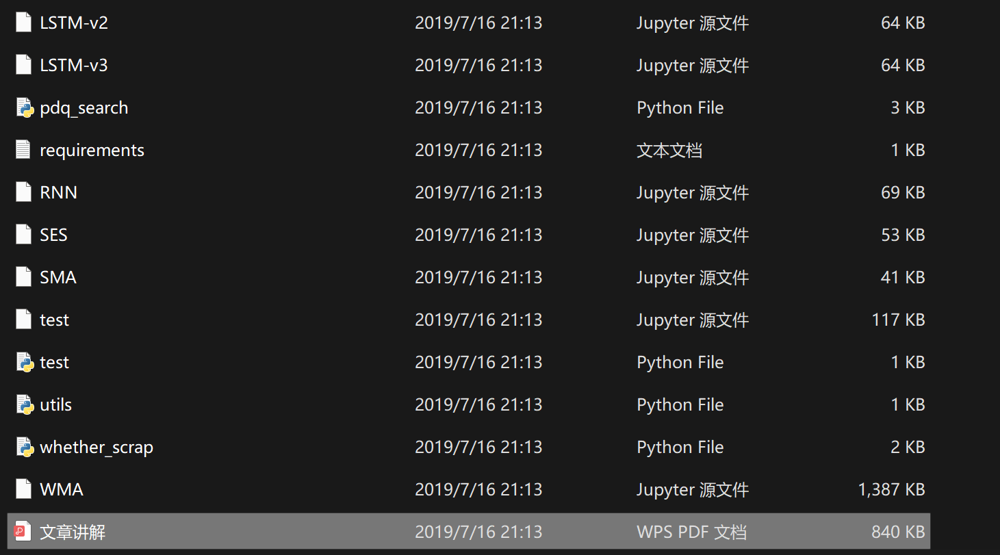
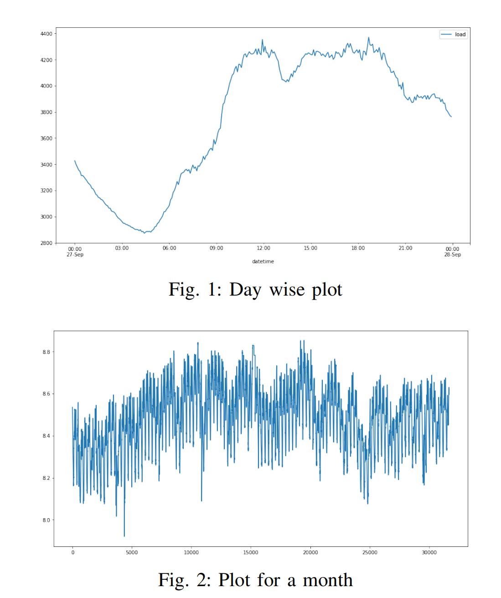
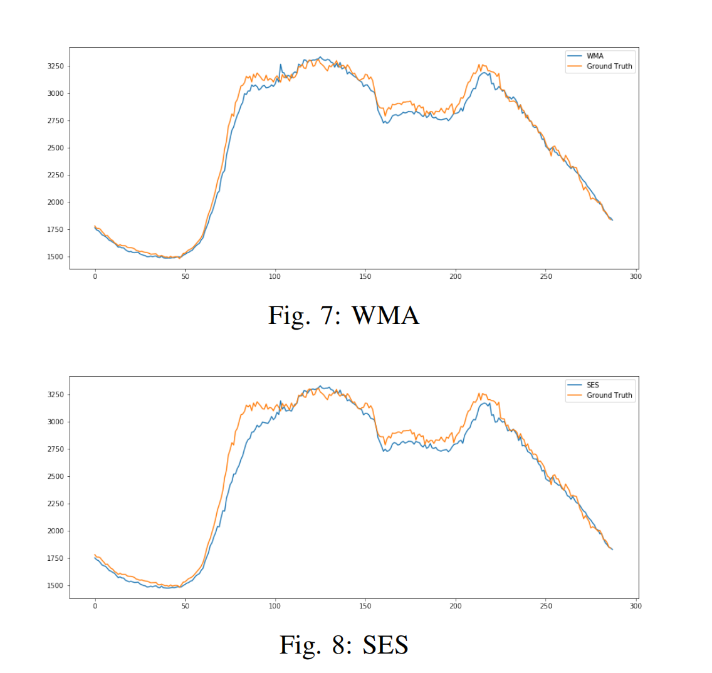

# Predicting Electricity Load Based on ARIMA, RNN, LSTM, and GRU Models (Python Code Implementation)

Predicting Electricity Load Based on ARIMA, RNN, LSTM, and GRU Models (Python Code Implementation)
Here are only some of the results.
\n\n\n\n\n\n\n\n\n\n

## Images

<!-- PAYMENT_BLOCK -->

## Get this dataset

- Payment link (Stripe): [Buy now](https://buy.stripe.com/3cs8yP7sY87d0vu9AB)
- Payment QR code: 

<!-- /PAYMENT_BLOCK -->
